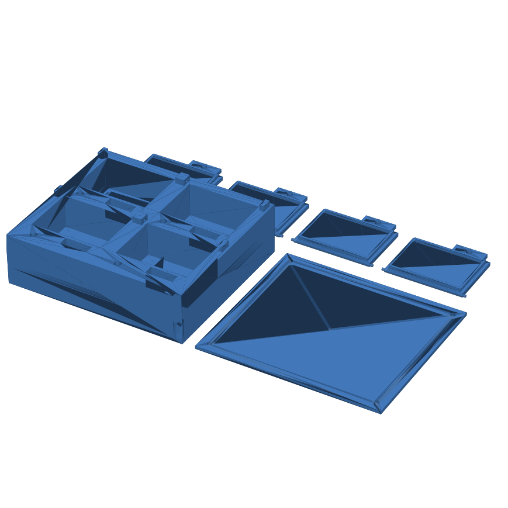

# Caixa de remédios

Caixa de remédios com ESP32 e 4 compartimentos. Na hora de cada dose, o buzzer toca e o LED do compartimento certo acende; abrir a tampa registra a dose como tomada. Funciona sem computador e sem internet. O celular serve só para programar os remédios.



As regras completas estão em [docs/regras-de-negocio.md](docs/regras-de-negocio.md).

## Hardware

| Peça | Quantidade | Observação |
| --- | --- | --- |
| ESP32 DevKit | 1 | |
| Sensor de tampa (chave fim de curso ou reed + ímã) | 4 | Um por compartimento |
| LED + resistor de 220 Ω | 4 | Um por compartimento |
| Buzzer passivo | 1 | |
| Módulo RTC DS3231 | 1 | Recomendado: mantém a hora sem internet |
| Caixa impressa em 3D | 1 | [hardware/caixa-todas-as-pecas.stl](hardware/caixa-todas-as-pecas.stl) |

### Ligações

| Compartimento | Sensor da tampa | LED |
| --- | --- | --- |
| 1 | GPIO 23 | GPIO 26 |
| 2 | GPIO 32 | GPIO 27 |
| 3 | GPIO 33 | GPIO 14 |
| 4 | GPIO 25 | GPIO 13 |

- Sensores: um terminal no GPIO, outro no GND (o ESP usa pull-up interno). Tampa fechada = contato fechado.
- Buzzer: GPIO 19. RTC: SDA no GPIO 21, SCL no GPIO 22, alimentação 3,3 V.
- Os pinos estão em [`firmware/include/config.h`](firmware/include/config.h) e podem ser trocados.

## Gravando a caixa

Requer [PlatformIO](https://platformio.org/) (extensão do VS Code ou `pip install platformio`).

```bash
cd firmware
cp include/segredos.exemplo.h include/segredos.h   # e preencha as senhas
pio run -t upload       # grava o firmware
pio run -t uploadfs     # grava o painel web
pio device monitor      # acompanha o log pela USB
```

## Usando

1. Conecte o celular na rede **CaixaDeRemedios** (senha definida em `segredos.h`) e abra `http://192.168.4.1`. Se a caixa estiver na rede da casa, use `http://caixa.local`.
2. Entre com o usuário e a senha do painel.
3. Se aparecer o aviso de hora, toque em **Acertar hora agora**.
4. Cadastre cada remédio com compartimento, horários e dias da semana.

## Desenvolvimento

```
firmware/
  lib/core/       regras de negócio, sem Arduino (testáveis no computador)
  src/            hardware, relógio, armazenamento (LittleFS) e painel web
  data/           página do painel
  test/           testes das regras
docs/             regras de negócio
hardware/         modelo 3D
```

Testes das regras de negócio, no computador:

```bash
cd firmware
pio test -e native
```

O GitHub Actions roda os testes e compila o firmware a cada push e PR.

## Aviso

Este é um lembrete de uso doméstico, não um dispositivo médico certificado.
